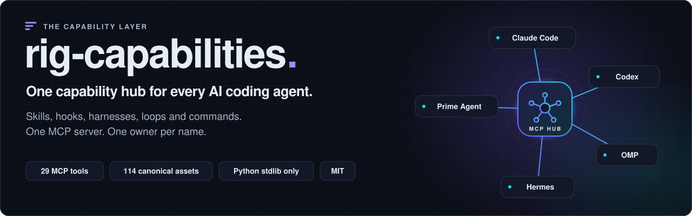
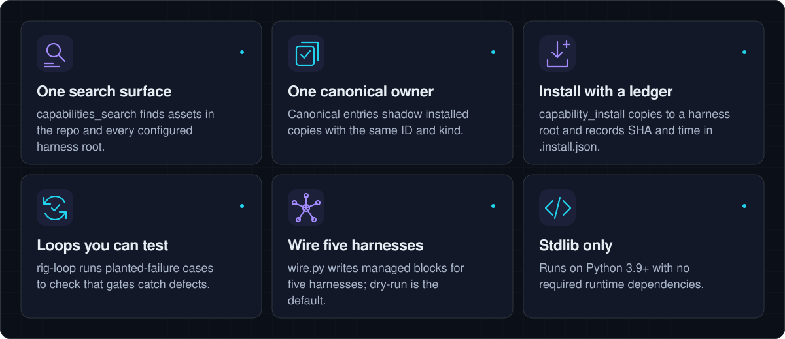
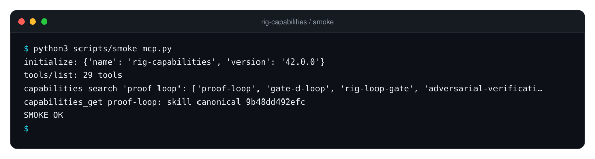
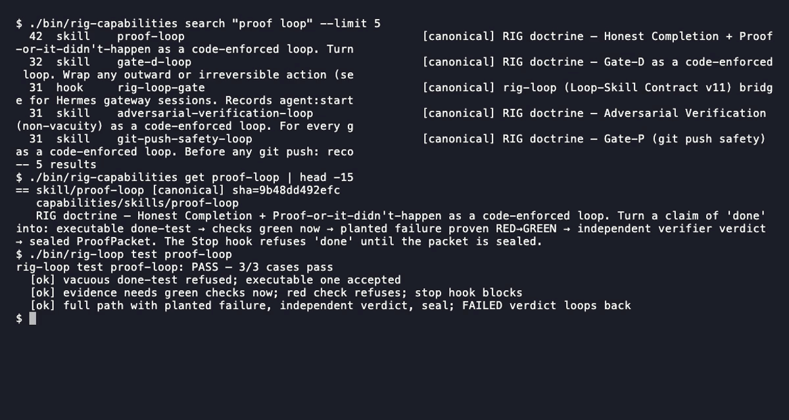
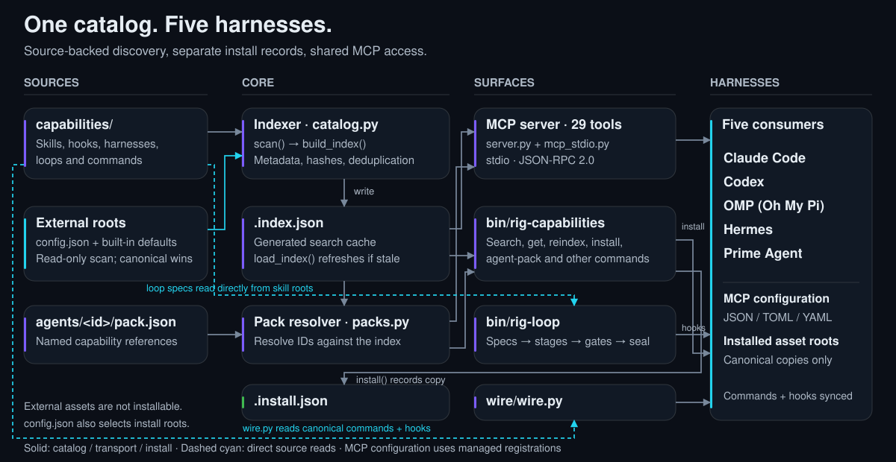
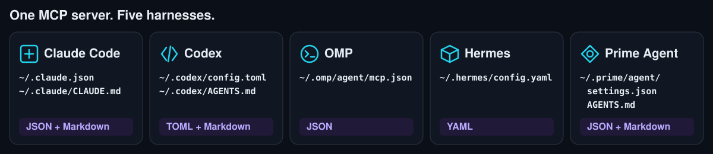
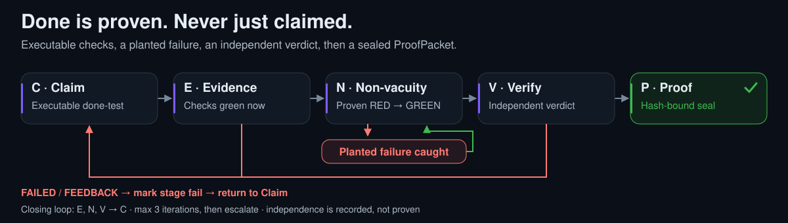
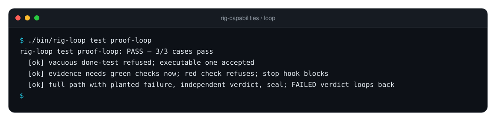

<div align="center">

<picture>
  <source media="(prefers-color-scheme: dark)" srcset="docs/assets/hero-dark.svg">
  <source media="(prefers-color-scheme: light)" srcset="docs/assets/hero-light.svg">
  
</picture>

<p>
  <a href="https://github.com/mrodgersjs-web/rig-capabilities/actions/workflows/ci.yml"></a>
  
  
  
  
  <a href="LICENSE"></a>
</p>

<p>
  <a href="#-quickstart"><b>Quickstart</b></a> ·
  <a href="#-how-it-works"><b>How it works</b></a> ·
  <a href="#-connect-your-agent"><b>Connect your agent</b></a> ·
  <a href="#-loop-skills-doctrine-you-can-test"><b>Loop-skills</b></a> ·
  <a href="#-reference"><b>Reference</b></a> ·
  <a href="#-contributing"><b>Contributing</b></a>
</p>

</div>

Every AI coding agent keeps its own pile of skills, hooks and prompts in a hidden dotfile folder. Nothing is indexed, nothing has an owner, and the same skill drifts into five slightly different copies.

**rig-capabilities** fixes that. It is one git-versioned catalog for skills, hooks, goal harnesses, loops and commands, plus the agent packs that bundle them. One stdlib-only MCP server serves it to **Claude Code, Codex, OMP, Hermes and Prime Agent**. Search everything from any agent. One owner per name. Every install recorded.

<p align="center">
  
  <br>
  <sub>How it works in 15 seconds: <b>search</b> the catalog, <b>serve</b> a capability to every agent, <b>prove</b> it with a loop that catches planted failures. <a href="docs/assets/how-it-works.mp4">MP4</a></sub>
</p>

<picture>
  <source media="(prefers-color-scheme: dark)" srcset="docs/assets/features-dark.svg">
  <source media="(prefers-color-scheme: light)" srcset="docs/assets/features-light.svg">
  
</picture>

## ⚡ Quickstart

Requires Git and Python 3.9+. Four commands from zero to a working MCP server:

```sh
git clone https://github.com/mrodgersjs-web/rig-capabilities.git && cd rig-capabilities
python3 -m venv .venv && . .venv/bin/activate && python -m pip install --upgrade pip
pip install -e ".[test]"          # add ,yaml to read loop.yaml directly (optional)
python scripts/smoke_mcp.py       # starts the server, lists tools, runs a search
```

You should see:

<p align="center">
  
</p>

Now search the catalog and run a loop's planted-failure tests:

```sh
./bin/rig-capabilities search "proof loop"
./bin/rig-capabilities get proof-loop
./bin/rig-loop test proof-loop
```

<p align="center">
  
</p>

> [!TIP]
> Install editable (`-e`) or set `RIG_CAP_REPO=/path/to/checkout`. The server reads `capabilities/`, `config.json` and `.index.json` from the checkout, not from site-packages.

## 🧭 How it works

<picture>
  <source media="(prefers-color-scheme: dark)" srcset="docs/assets/architecture-dark.svg">
  <source media="(prefers-color-scheme: light)" srcset="docs/assets/architecture-light.svg">
  
</picture>

<table>
<tr>
<td width="50%" valign="top">

<h3>1. One search surface</h3>
<code>capabilities_search</code> covers this repo <i>plus</i> every configured harness root (<code>~/.claude</code>, <code>~/.codex</code>, <code>~/.hermes</code>, ...). External roots are indexed read-only and never moved. Search before you author or install anything new.
</td>
<td width="50%" valign="top">

<h3>2. One owner per name</h3>
A canonical entry in <code>capabilities/</code> shadows any same-named install elsewhere. Canonicalizing an asset (<code>rig-capabilities add</code>) is how you take ownership of it.
</td>
</tr>
<tr>
<td width="50%" valign="top">

<h3>3. Distribute, don't copy-paste</h3>
<code>rig-capabilities install &lt;id&gt; --harness claude</code> (or the <code>capability_install</code> MCP tool) copies the canonical asset into a harness root and records target, sha and timestamp in <code>.install.json</code>.
</td>
<td width="50%" valign="top">

<h3>4. Prove it, don't claim it</h3>
Loop-skills turn doctrine into stage gates decided by files and exit codes. Every loop ships planted-failure cases, so a gate that never fails is caught.
</td>
</tr>
</table>

## 🔌 Connect your agent

<picture>
  <source media="(prefers-color-scheme: dark)" srcset="docs/assets/harnesses-dark.svg">
  <source media="(prefers-color-scheme: light)" srcset="docs/assets/harnesses-light.svg">
  
</picture>

**All five at once.** Start each harness once so its config exists, then:

```sh
python3 wire/wire.py            # dry run: shows every change it would make
python3 wire/wire.py --apply    # writes managed blocks, backs up edited files
```

| Harness | Config written | Format |
| --- | --- | --- |
| Claude Code | `~/.claude.json`, `~/.claude/CLAUDE.md` | JSON + Markdown |
| Codex | `~/.codex/config.toml`, `~/.codex/AGENTS.md` | TOML + Markdown |
| OMP (Oh My Pi) | `~/.omp/agent/mcp.json` | JSON |
| Hermes | `~/.hermes/config.yaml` | YAML |
| Prime Agent | `~/.prime/agent/settings.json`, `~/.prime/agent/AGENTS.md` | JSON + Markdown |

TOML, YAML and Markdown edits sit inside managed marker blocks and JSON gets a single named `rig-capabilities` entry, so re-running is safe. `--apply` registers the server in every harness config that exists and skips missing ones. It also syncs canonical commands and hooks into each harness's command and hook folders. Restart your client afterwards. `./install.sh`, `./install.sh --apply` and `./install.sh --verify` wrap the same flow.

<details>
<summary><b>Any other MCP client</b> (Cursor, Claude Desktop, VS Code, ...)</summary>

<br>

Merge this into your client's `mcpServers` config. Replace both paths with your checkout.

```json
{
  "mcpServers": {
    "rig-capabilities": {
      "command": "/absolute/path/rig-capabilities/.venv/bin/python",
      "args": ["-m", "rig_capabilities"],
      "env": { "RIG_CAP_REPO": "/absolute/path/rig-capabilities" }
    }
  }
}
```

`RIG_CAP_REPO` selects the catalog checkout, independent of the client's working directory.

</details>

## 🔁 Loop-skills: doctrine you can test

<picture>
  <source media="(prefers-color-scheme: dark)" srcset="docs/assets/loop-dark.svg">
  <source media="(prefers-color-scheme: light)" srcset="docs/assets/loop-light.svg">
  
</picture>

Every RIG doctrine ships as a **loop-skill**: `capabilities/skills/<id>/{SKILL.md, loop.yaml, tests/cases.json}`. The `rig-loop` engine (`bin/rig-loop`, stdlib only) decides stage gates from files and exit codes, refuses out-of-order advance, denies outward actions until a typed `APPROVE <run_id>`, and seals a ProofPacket. Contract: [docs/LOOP-SKILLS-V11.md](docs/LOOP-SKILLS-V11.md).

<p align="center">
  
</p>

| Loop-skill | Stages |
|---|---|
| `proof-loop` | C E N V P |
| `gate-d-loop` | C D R A X P |
| `adversarial-verification-loop` | G R N K P |
| `north-star-lock-loop` | L D S C P |
| `phase-discipline-loop` | O B V T C P |
| `git-push-safety-loop` | V D L A X S P |
| `iqrsqpi-v20` (`/iqrsqpi`) | I1 Q1⇄R(dry) S B(slices) Q2(other-family verdict) P(calibration) I2(handoff) |
| `iqrsqpi-v20-slice` | B V C, a child loop per context-sized slice |

```sh
./bin/rig-loop wire --apply                         # one-time: install the stage hooks in your harnesses
./bin/rig-loop activate proof-loop --intent "..."   # start a run; hooks now enforce stages
./bin/rig-loop stage C pass                         # refused while the gate is red
./bin/rig-loop test proof-loop                      # planted-failure cases (non-vacuity)
./bin/rig-loop doctor                               # wiring + install state across 5 harnesses
```

## 📁 Layout

```
capabilities/
  skills/<id>/SKILL.md      agent skills; loop-skills add loop.yaml + loop.json + tests/cases.json
  hooks/<id>.sh|.py|.ts     hook scripts (canonical source for settings.json wiring)
  harnesses/<id>.yaml       goal harnesses
  loops/<id>.md             goal loops
  commands/<id>.md          slash commands
agents/<id>/pack.json       agent packs: the skills/harnesses each agent runs on
rig_capabilities/           package: catalog, live probe, outcome taxonomy, MCP server
bin/rig-capabilities        CLI (--help lists every subcommand)
bin/rig-loop                loop-skill engine CLI
wire/wire.py                multi-harness MCP wiring installer (managed markers)
scripts/smoke_mcp.py        end-to-end stdio smoke test (used by CI)
.index.json                 generated search index (gitignored; rebuild: reindex)
.install.json               install ledger (committed)
```

On `main` today: **19** skills, **9** hooks, **64** goal harnesses, **15** loops, **7** commands and **24** agent packs, plus whatever your local harness roots hold.

## 📚 Reference

<details><summary><b>All 29 MCP tools</b></summary>

Source: [`rig_capabilities/server.py`](rig_capabilities/server.py), `TOOLS` descriptions and input schemas. `*` marks a required argument. Other arguments are optional.

### Discover

| Tool | What it does | Key args |
| --- | --- | --- |
| `capabilities_search` | Search canonical and installed capabilities. Canonical entries get a ranking bonus. | `query*`; `kind`, `limit` |
| `capabilities_get` | Fetch capability metadata and content, preferring the canonical copy. | `id*` |
| `capabilities_list` | List capabilities filtered by their kind and source. | `kind`, `source`, `limit` |
| `capabilities_outcomes` | Browse outcome lanes with capability counts for each kind. | None |
| `capabilities_route` | Rank outcome lanes and matching capabilities for an intent. | `query*`; `per` |
| `capabilities_public_catalog` | Return catalog assets whose access rules include public. | None |

### Install

| Tool | What it does | Key args |
| --- | --- | --- |
| `capability_install` | Copy canonical assets into a chosen harness with ledger tracking. | `id*`, `harness*`; `force` |
| `capability_add` | Import an asset into the canonical repository and rebuild its index. | `id*`, `kind*`, `source_path*`; `overwrite` |
| `capabilities_release` | Build a public catalog archive locally, without publishing releases. | `apply` |

### Context

| Tool | What it does | Key args |
| --- | --- | --- |
| `capabilities_context_pack` | Assemble task context filtered by trust and access rules. | `intent*`; `budget_tokens`, `max_nodes`, `min_trust`, `requester`, `token` |
| `capabilities_graph` | Expand related capabilities around an asset through graph edges. | `id*`; `depth` |
| `capabilities_concepts` | Find capability identifiers by a normalized concept or tag. | `concept*`; `limit` |
| `capabilities_agent_pack` | Resolve agent packs, optionally adding live state and done-test results. | `agent`, `boot`, `intent` |
| `capabilities_issue_token` | Issue a signed requester token using a configured signing key. | `agent*`; `ttl` |

### Quality / Proof

| Tool | What it does | Key args |
| --- | --- | --- |
| `capabilities_test` | Run executable asset checks and report whether all runnable checks pass. | `id*` |
| `capabilities_round` | Upgrade weak capability contracts only when their done-tests pass. | `lane`, `n`, `dry` |
| `capabilities_certify` | Run certification gates, optionally proving each catches planted failures. | `plant` |
| `capabilities_gaps` | Rank coverage gaps and optionally write draft harnesses. | `n`, `apply` |
| `capabilities_overlay_status` | Report language-model overlay coverage without treating short files as complete. | `target` |
| `capabilities_proofchain` | Verify roadmap proof packet prefixes against recorded proof hashes. | None |
| `capabilities_quality_report` | Report quality-contract coverage for canonical assets, weakest assets first. | None |

### Ops

| Tool | What it does | Key args |
| --- | --- | --- |
| `capabilities_stats` | Report capability counts, index freshness, and the install ledger. | None |
| `capabilities_reindex` | Rescan the repository and external roots, returning updated counts. | None |
| `capabilities_live_status` | Check runtime wiring, installations, command availability, and service identity. | `id`, `services` |
| `capabilities_refresh` | Report root drift and optionally rebuild a stale index. | `apply` |
| `capabilities_analytics` | Write per-asset context pack usage and rating analytics. | None |
| `capabilities_connectors` | Report configured SQL and API connectors with their last errors. | None |
| `capabilities_observe` | Report local traces and whether Langfuse can be reached. | None |
| `capabilities_db_sync` | Sync the capability index and pack ratings into Postgres. | `dsn` |

</details>

<details><summary><b>CLI commands</b></summary>

Run from the repository root. These tables cover every top-level subcommand. They show key arguments, not every flag. Use a subcommand’s `--help` for its full syntax.

### rig-capabilities

Source: [`bin/rig-capabilities`](bin/rig-capabilities), `--help` and the argument parser.

| Command | What it does |
| --- | --- |
| `./bin/rig-capabilities stats` | Report counts by kind and source plus install ledger. |
| `./bin/rig-capabilities reindex` | Rescan the repository and all external roots. |
| `./bin/rig-capabilities agent-pack [agent] [--boot] [--intent T]` | Resolve an agent pack, boot state, or intent match. |
| `./bin/rig-capabilities gaps [--n N] [--dry]` | Draft gap harnesses; use --dry to avoid writes. |
| `./bin/rig-capabilities release [--dry]` | Build a local public catalog archive; --dry previews. |
| `./bin/rig-capabilities harness-install [--dest P] [--apply]` | Preview or apply a harness installation. |
| `./bin/rig-capabilities proofchain` | Verify roadmap packet prefixes against proof hashes. |
| `./bin/rig-capabilities search <query> [--kind K] [--limit N]` | Search canonical and external capability entries. |
| `./bin/rig-capabilities list [--kind K] [--source S] [--limit N]` | List entries filtered by kind and source. |
| `./bin/rig-capabilities get <id>` | Print matching capability metadata. |
| `./bin/rig-capabilities add <id> --kind K --path P [--overwrite]` | Copy an asset into the canonical repository. |
| `./bin/rig-capabilities install <id> --harness H [--force] [--kind K]` | Copy a canonical asset into a harness root. |
| `./bin/rig-capabilities wire [--apply] [--verify]` | Preview, apply, or verify capability wiring. |
| `./bin/rig-capabilities live [id] [--no-services]` | Report runtime wiring and optional service probes. |
| `./bin/rig-capabilities tree [--out P]` | Rebuild the outcome and kind browsing tree. |
| `./bin/rig-capabilities route <query> [--per N]` | Rank outcome lanes and matching assets. |
| `./bin/rig-capabilities outcomes` | Report counts for each outcome lane. |
| `./bin/rig-capabilities fabric-build` | Build the graph and concept indexes plus an embeddings cache. |
| `./bin/rig-capabilities okf-check` | Report metadata completeness. |
| `./bin/rig-capabilities trusts` | Report observation and rating trust data. |
| `./bin/rig-capabilities analytics` | Write per-asset context usage and rating analytics. |
| `./bin/rig-capabilities publish` | Write the local public catalog file. |
| `./bin/rig-capabilities pack <intent> [--budget N] [--max-nodes N] [--min-trust F] [--acl a,b] [--requester NAME] [--token TOKEN]` | Assemble a filtered context pack for an intent. |
| `./bin/rig-capabilities graph <id> [--depth N]` | Expand the capability graph from one asset. |
| `./bin/rig-capabilities concepts <concept> [--limit N]` | Look up capability identifiers by concept. |
| `./bin/rig-capabilities concepts-build [--llm] [--llm-only] [--status] [--n N]` | Build concept indexes or report overlay status. |
| `./bin/rig-capabilities rate <pack_id> <verdict> [note]` | Record useful, partial, or wasted pack feedback. |
| `./bin/rig-capabilities registry status [--id ID] [--fetch]` | Report repository registry health, optionally fetching updates. |
| `./bin/rig-capabilities refresh [--apply]` | Report drift; optionally rebuild a stale index. |
| `./bin/rig-capabilities sign [pack_id] [--generate-key]` | Sign a context pack or generate a signing key. |
| `./bin/rig-capabilities verify <pack_id>` | Verify a context pack signature. |
| `./bin/rig-capabilities serve [--port N] [--bind HOST] [--token TOKEN]` | Start the HTTP federation surface. |
| `./bin/rig-capabilities serve-token [--generate]` | Report token configuration or generate a service token. |
| `./bin/rig-capabilities issue-token <agent> [--ttl N] [--mint-key]` | Issue a signed requester token. |
| `./bin/rig-capabilities verify-token <token>` | Validate a requester token. |
| `./bin/rig-capabilities quality [--weakest N] [--migrate]` | Report quality contracts; optionally migrate canonical assets. |
| `./bin/rig-capabilities reclassify [--apply]` | Preview or apply outcome lane assignments. |
| `./bin/rig-capabilities coverage` | Run the coverage matrix report. |
| `./bin/rig-capabilities db-sync [--dsn DSN]` | Sync the index and pack ratings into Postgres. |
| `./bin/rig-capabilities test <id>` | Run an asset’s executable done-tests. |
| `./bin/rig-capabilities quality-run [--lane L]` | Run quality checks, optionally restricted to one lane. |
| `./bin/rig-capabilities round <lane> [--n N] [--dry]` | Run a contract improvement round; --dry avoids writes. |
| `./bin/rig-capabilities connectors` | Report SQL and API connector status. |
| `./bin/rig-capabilities observe` | Report local trace and Langfuse status. |

### rig-loop

Source: [`bin/rig-loop`](bin/rig-loop), `--help` and the argument parser. `gate-d` has separate request and approval rows. Approval is a human step. A request alone does not authorize an action.

| Command | What it does |
| --- | --- |
| `./bin/rig-loop activate <loop-id> [--intent T] [--mode auto\|walk] [--cwd DIR] [--harness H] [--if-inactive]` | Activate a loop run for a working directory. |
| `./bin/rig-loop status [--json] [--run RUN_ID]` | Show the current run and its stage status. |
| `./bin/rig-loop stage <STAGE> <pass\|fail\|park> [--artifact P] [--score N] [--note T] [--force]` | Record a stage outcome and optional evidence. |
| `./bin/rig-loop artifact <STAGE> <PATH>` | Bind an artifact path to a stage. |
| `./bin/rig-loop path` | Print the run’s artifact directory. |
| `./bin/rig-loop counter <name> [--set N\|--inc]` | Read, set, or increment a run counter. |
| `./bin/rig-loop check <add\|run\|rm\|list> [cmd]` | Manage and run executable checks. |
| `./bin/rig-loop plant <name> --red CMD --green CMD` | Record a planted failure and its passing repair. |
| `./bin/rig-loop gate-d request --action T` | Record an approval request for the run. |
| `./bin/rig-loop gate-d approve --phrase PHRASE [--by PRINCIPAL]` | Record approval only with the required run phrase. |
| `./bin/rig-loop seal [--signer NAME]` | Seal the run’s proof packet after gate checks. |
| `./bin/rig-loop park --reason T` | Park the active run with a reason. |
| `./bin/rig-loop resume <run_id>` | Resume a parked loop run. |
| `./bin/rig-loop close [--reason T]` | Close the active run. |
| `./bin/rig-loop qr pass --new-unknowns N [--note T]` | Record a question and research pass. |
| `./bin/rig-loop slice <start\|list> [name] [--loop ID]` | Start a child slice or list existing slices. |
| `./bin/rig-loop verify --family FAMILY [--cmd CMD] [--timeout N] [--dry-run]` | Run a verifier or preview its prompt. |
| `./bin/rig-loop handoff [--to PATH]` | Write a handoff, optionally copying it elsewhere. |
| `./bin/rig-loop calibration [--loop ID]` | Report verifier calibration, optionally filtered by loop. |
| `./bin/rig-loop hook <event> [--format claude\|codex\|pi\|text] [--skill ID]` | Dispatch a lifecycle hook and render its result. |
| `./bin/rig-loop wire [--apply] [--verify] [--remove] [--harness H ...]` | Preview, apply, verify, or remove loop wiring. |
| `./bin/rig-loop doctor [--json]` | Check loop engine health and wiring. |
| `./bin/rig-loop list` | List loop runs and the active run per directory. |
| `./bin/rig-loop specs [--all]` | Show loop specifications. |
| `./bin/rig-loop test <loop-id> [--json]` | Run a loop’s test cases. |
| `./bin/rig-loop compile <loop-id>` | Write loop.json beside its YAML specification. |
| `./bin/rig-loop scaffold <loop-id> --name N [--source PATH] [--summary T]` | Create a loop specification from supplied metadata. |

</details>

Deeper docs: [Context fabric](docs/CONTEXT-FABRIC.md) · [Outcome lanes](docs/OUTCOMES.md) · [Loop-skills v11](docs/LOOP-SKILLS-V11.md) · [Roadmap](docs/ROADMAP.md)

## ✅ Tests and CI

```sh
pytest -m "not live_estate"            # what CI runs
python -m unittest discover -s tests   # stdlib runner, includes live-estate tests
ruff check .
```

[`ci.yml`](.github/workflows/ci.yml) runs on every push and pull request, on Python 3.9 and 3.12, with and without PyYAML: install, ruff, the test suite, then two smoke steps (the MCP server answering `capabilities_search` and `capabilities_get` over stdio, and the CLI plus `rig-loop test proof-loop`). CI sets a throwaway `RIG_CAPABILITIES_SIGNING_KEY` per run so the token and pack-signing gates are exercised for real. Tests marked `live_estate` need an operator machine (an external corpus root and a local Postgres) and are deselected in CI.

## 🤝 Contributing

**Search before adding anything.** Reuse an existing capability when it already covers the task.

```sh
./bin/rig-capabilities search "capability keywords"
./bin/rig-capabilities add <id> --kind K --path P    # K: skill, agent, hook, harness, loop, command
./bin/rig-capabilities reindex
pytest -m "not live_estate" && ruff check .
```

<details>
<summary><b>Doctrine</b></summary>

1. **Search before you build or install.** Most ideas already exist somewhere. Canonical hits get a ranking bonus over external ones.
2. **Canonicalize before distributing.** Anything worth installing into a second harness belongs in `capabilities/` first.
3. **License boundary.** MIT/Apache upstreams may be forked into RIG-branded assets. CC-BY-SA is consumed in place as marketplace plugins, never rebranded. Record provenance in the asset's frontmatter.
4. **No fake memory.** A capability that is a stub or mock is either wired real or deleted.
5. **Destructive changes are one commit, after the replacement verifies.**

</details>

<details>
<summary><b>Known gaps</b></summary>

- CI coverage for the `live_estate` tests needs a bundled fixture corpus and a Postgres service container.
- Dense retrieval and Langfuse export are only exercised where a local ollama or Langfuse is configured. CI covers the BM25/lane/graph path and the "unconfigured" path.
- Hook wiring into real harness configs is tested against temp copies. Check live wiring with `rig-loop doctor` and `./install.sh --verify`.
- A non-editable wheel install needs `RIG_CAP_REPO` set, because the catalog is read from the checkout.

</details>

<details>
<summary><b>Provenance and credits</b></summary>

MCP stdio transport and the wiring installer are adapted from `jake-pai-mcp` (same owner, MIT). External-root and install-root maps default to the RIG layout in `rig_capabilities/catalog.py` and `config.json`. Illustrations and the how-it-works animation were generated with [Higgsfield](https://higgsfield.ai). Diagrams and terminal captures are hand-built SVGs from real command output.

</details>

<div align="center">
<br>
<sub>MIT licensed · built by <a href="https://github.com/mrodgersjs-web">@mrodgersjs-web</a> · if this saves you a skill rewrite, a ⭐ helps others find it</sub>
</div>

Part of the [mrodgersjs-web](https://github.com/mrodgersjs-web) FDE studio fleet. [rodgersintelligence.com](https://rodgersintelligence.com)
